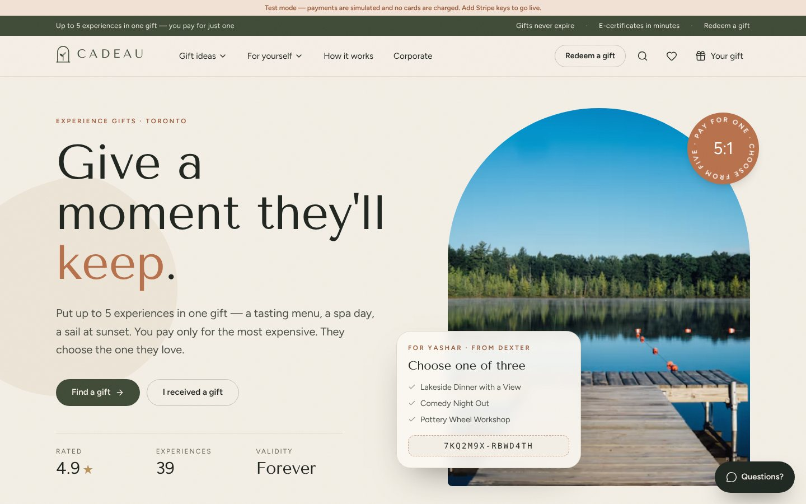
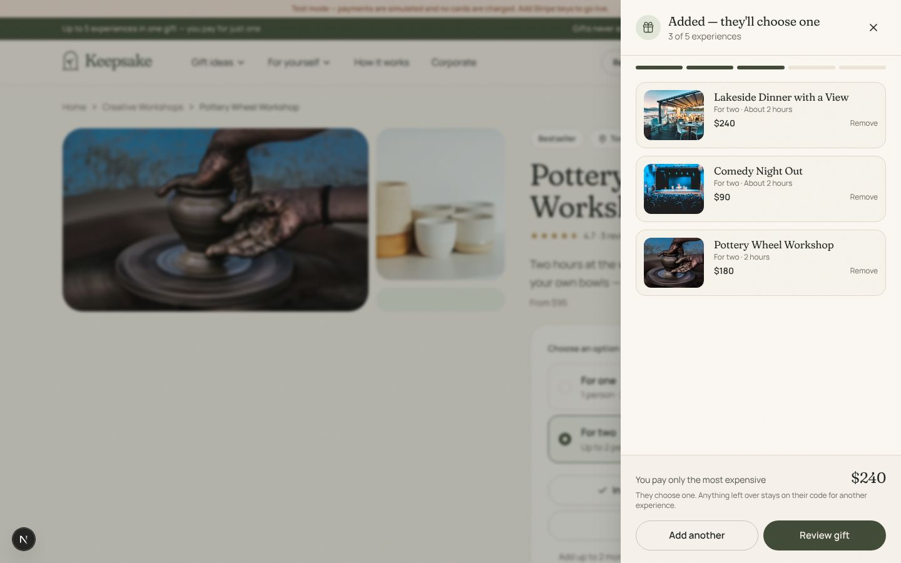
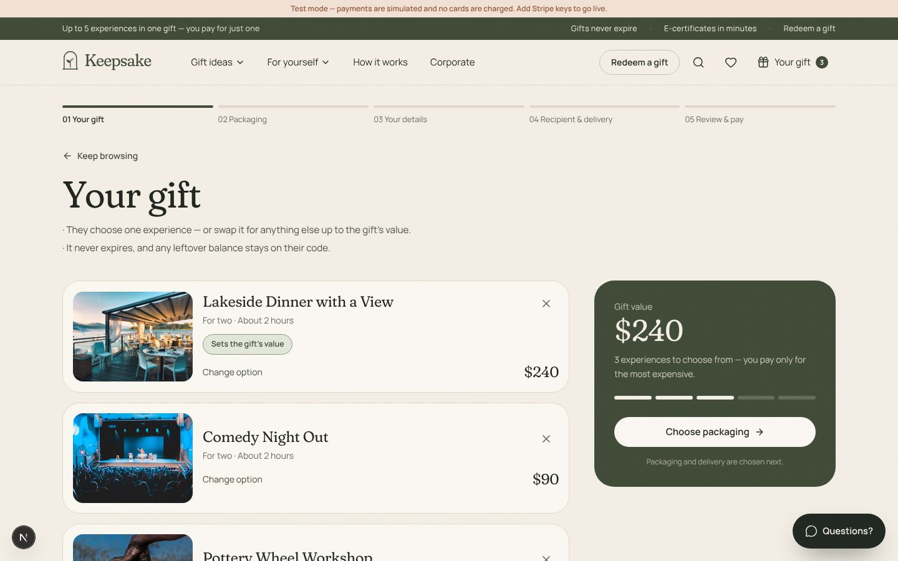
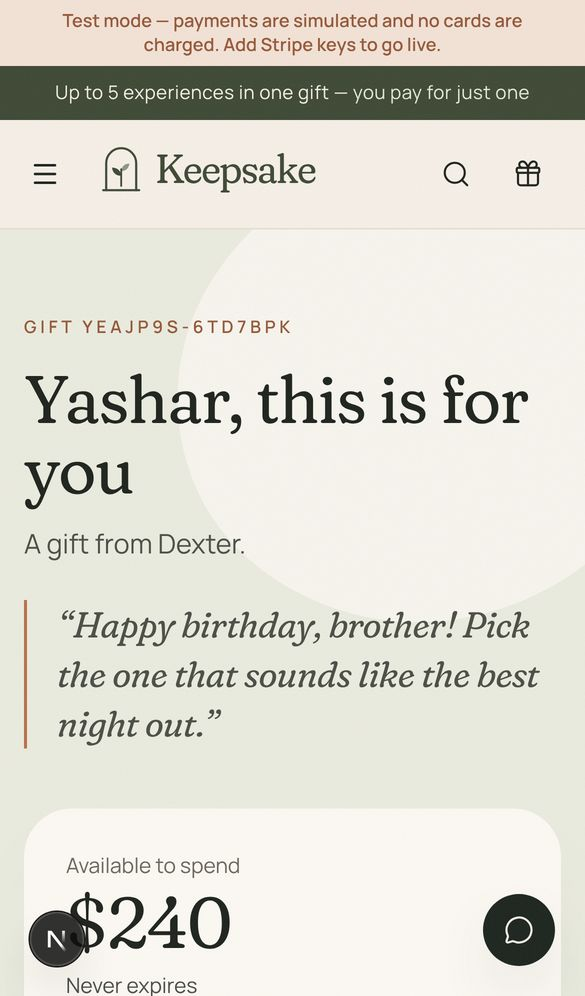
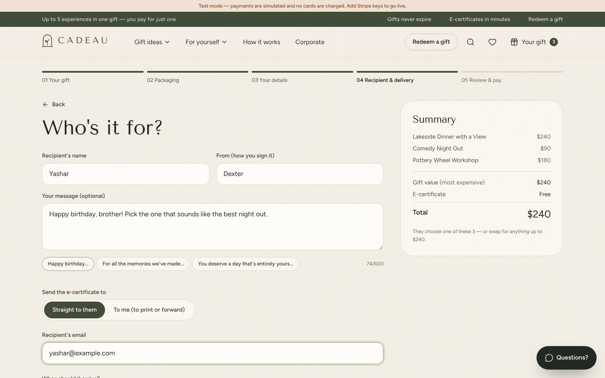
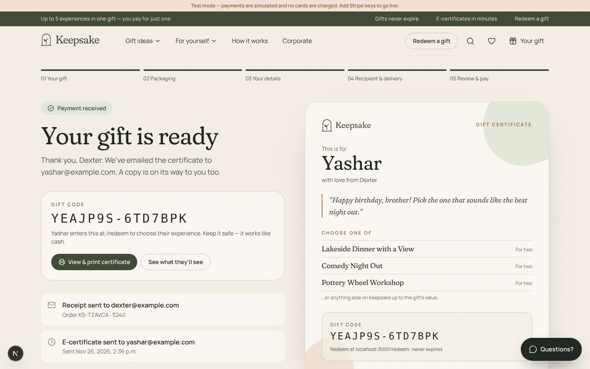
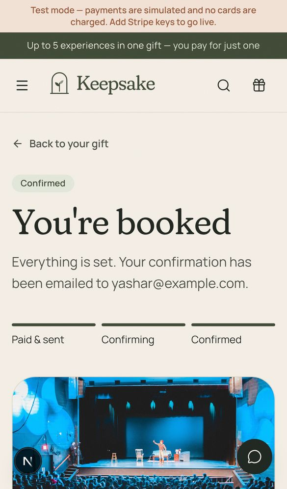

# Keepsake — experience gifts, Toronto

A complete experience-gifting website and back office, modelled on the business mechanics of [bodo.ua](https://www.bodo.ua/ua/) with an original, calm and organic design.

> **Dexter wants to give his brother Yashar a memorable experience.** He puts a lakeside dinner, a comedy night and a pottery workshop into one gift, and **pays only for the most expensive** ($240). Keepsake issues a **random 14-character code** linked to those three experiences, wraps it as an e-certificate (or a gift box), and delivers it. Yashar enters the code on the website, sees his gift, **chooses the one he wants** (or swaps for anything else up to $240), picks his dates, and the team confirms the booking. Anything he doesn't spend stays on the same code for later; anything pricier, he tops up.



| Dexter builds the gift | …pays for the most expensive | Yashar opens his code |
|---|---|---|
|  |  |  |
|  |  |  |

More: [experience page](docs/screenshots/02-experience.jpg) · [admin bookings](docs/screenshots/09-admin-bookings.jpg) · [certificate email](docs/screenshots/10-certificate-email.jpg) · [what was taken from the bodo.ua review](docs/REFERENCE_REVIEW.md)

---

## Quick start

Requires Node.js 20.9+.

```bash
npm install
npm run dev          # http://localhost:3000
```

That's it — no database to install. On first start the app creates an embedded Postgres database in `./.data/` and fills it with a **sample Toronto catalog** (39 experiences across 16 categories).

- Admin: http://localhost:3000/admin — development password `keepsake-admin`
- Payments run in **test mode** until you add Stripe keys (a simulated card page, nothing is charged).
- Emails are not sent until you configure SMTP; you can read every one of them in **Admin → Emails**.

```bash
npm test             # business-rule tests (pricing, codes, redemption, top-ups, security) on a real in-memory Postgres
npm run e2e          # with the dev server running: the full Dexter → Yashar story in a real browser, screenshots in ./e2e-screenshots
npm run typecheck
npm run build && npm start   # production build
```

## What's included

**Storefront** — home page, catalog with filters (location, who it's for, category, price, group size, sort, search), category / recipient / occasion landing pages, experience pages (gallery, options, locations, reviews, how gifting works, what the gift looks like, delivery, FAQ, similar), wishlist with a shareable link, "book for yourself", how it works (giver / recipient / self-booking), delivery & payment, corporate gifts with enquiry form, help centre, contact, about, reviews, legal pages, 404.

**Gifting** — gift box with up to 5 experiences and a slide-in drawer; checkout: packaging (e-certificate or gift box in 5 colourways) → your details → recipient, message and delivery (send now or schedule to the minute in Toronto time; courier / Xpresspost / pickup with address) → review & pay. Printable certificate page with QR code.

**The 14-character code (backend)** — on payment, the server creates exactly one certificate per order with a random code linked to the purchased experiences (with their prices locked in). Codes use Crockford Base32 (no I/L/O/U look-alikes): 32¹⁴ ≈ 1.2 × 10²¹ possibilities, generated with the operating system's secure random generator. Typing is forgiving (lowercase, spaces, dashes, O→0, I/L→1). Wrong guesses are rate-limited per IP.

**Redeeming** — `/redeem`: enter the code → see who it's from, the message, balance and the chosen experiences → choose one (or swap for anything up to the balance) → option, venue and two preferred dates → request. If the choice costs more than the balance, the recipient pays the difference online; the balance is held for 60 minutes while they pay. Leftover value stays on the code. Balance check at `/redeem?check=1`.

**Back office** (`/admin`) — dashboard with revenue, outstanding gift balances and a launch checklist; orders (gift-box fulfilment status, tracking, re-send certificate, cancel & void code); bookings queue (confirm with date/time → guest emailed automatically; decline → balance restored); gift-code lookup; catalog editor (texts, options, prices, venues, photos, categories, tags, visibility); review moderation (including one-click removal of the sample reviews); enquiries; email outbox with previews.

**Emails** — certificate to the recipient (optionally scheduled) with a copy to the buyer, order receipt, booking requested / confirmed / declined, and admin notifications.

## Business rules at a glance

| Rule | Where |
|---|---|
| Up to 5 experiences per gift, each experience once | `rules.maxGiftItems` in `src/lib/config.ts`, enforced in `src/lib/orders.ts` |
| Price = most expensive experience (+ box / delivery fees) | `src/lib/pricing.ts` |
| Prices are always re-read on the server — the browser's numbers are never trusted | `createOrder()` |
| One certificate per paid order, idempotent (safe if Stripe notifies twice) | `markOrderPaid()` |
| Price protection for the experiences in the gift | `quoteFor()` in `src/lib/redemptions.ts` |
| Swap / split / top-up / leftover balance | `createRedemption()`, `markTopUpPaid()` |
| Declined or cancelled bookings put the money back on the code | `cancelRedemption()` |
| Validity | `NEXT_PUBLIC_CERTIFICATE_VALID_MONTHS` (default 0 = never expires) |
| Packaging and delivery fees, box colours, greeting ideas | `src/lib/config.ts` |

## Put it online (about 10 minutes, free to start)

The website needs a host to be visible on the internet. The quickest path for this stack is **Vercel** (hosting) with **Neon** (database), both with free plans:

1. Go to **vercel.com** → *Sign Up* → **Continue with GitHub** (the GitHub account that owns this repository).
2. *Add New… → Project*, find **Gifting-Business-** and click **Import**. (Not listed? Click *Adjust GitHub App Permissions* and give Vercel access to the repository.)
3. Open **Environment Variables** and add:
   | Name | Value |
   |---|---|
   | `ADMIN_PASSWORD` | a password you choose, for `/admin` |
   | `SESSION_SECRET` | any long random text |
   | `ALLOW_TEST_PAYMENTS` | `true` — simulated payments until Stripe is connected |
4. Click **Deploy**.
5. In the new project open the **Storage** tab → **Create Database** → **Neon** (Serverless Postgres) → free plan, region closest to Toronto (e.g. US East) → **Connect** it to the project. This adds `DATABASE_URL` for you. *(Until this step the site runs on a temporary database that is wiped regularly.)*
6. **Deployments** → ⋯ on the latest one → **Redeploy**. Then click **Visit** — your site lives at an address like `gifting-business-xxxx.vercel.app`, and the admin at `/admin`.

The database tables and the sample catalog are created automatically on the first visit. Good to know:

- Vercel's free *Hobby* plan is for non-commercial use: perfect for previewing and testing. When you start selling, upgrade to *Pro* or use a host whose free tier allows commercial use (e.g. Netlify).
- When you add your own domain, set `NEXT_PUBLIC_SITE_URL` to it (otherwise the Vercel address is detected automatically).
- Scheduled e-certificates go out on the first visit after their time. For minute-exact delivery, set `CRON_SECRET` and have a free scheduler (e.g. cron-job.org) call `https://YOUR-SITE/api/cron/tick` every minute with the header `Authorization: Bearer YOUR_CRON_SECRET`.
- **Other hosts:** anything that runs `npm run build && npm start` with a `DATABASE_URL` (Netlify, Render, Railway, Fly.io, a VPS). On long-running servers you can even skip `DATABASE_URL` if you mount a persistent disk at `./.data`.

## Going live — checklist

The admin dashboard shows this checklist with live status.

1. **Brand & contact details** — `src/lib/config.ts` (name, email, phone, studio) or the `NEXT_PUBLIC_*` variables in `.env.example`.
2. **Your real catalog** — in Admin → Experiences, edit or hide the sample experiences and add your partners' offers and photos. Then **remove the sample reviews** (Admin → Reviews) and set `SEED_SAMPLE_DATA=false`. The sample venues, reviews and photos are placeholders: launching with them would mislead customers.
3. **Stripe** — create a Stripe account (Canada, CAD), set `STRIPE_SECRET_KEY`, add the webhook `https://YOUR-DOMAIN/api/payments/stripe/webhook` for `checkout.session.completed`, and set `STRIPE_WEBHOOK_SECRET`. Do one real test purchase with a `sk_test_` key first.
4. **Email** — any SMTP provider (Postmark, Resend, SendGrid, Mailgun…): set `SMTP_URL`, `MAIL_FROM` and optionally `ADMIN_NOTIFY_EMAIL`, and verify your sending domain (SPF/DKIM).
5. **Database** — set `DATABASE_URL` to a managed Postgres (Neon, Supabase, Render, Railway…). Tables are created automatically on first start, safely even when several servers start at once.
6. **Admin** — set `ADMIN_PASSWORD` and `SESSION_SECRET`.
7. **Hosting** — see *Put it online* above. Remove `ALLOW_TEST_PAYMENTS` once Stripe is live.
8. **Legal & tax** — the legal pages are templates. Have a Canadian lawyer review them, especially Ontario's gift-card rules (no expiry dates or dormancy fees on most gift cards) and refund terms, and ask an accountant how HST applies to gift certificates, packaging and delivery fees in your setup.

## Project structure

```
src/
  app/(site)/…         public pages (home, catalog, experience, checkout, redeem, info pages)
  app/admin/…          back office (login, dashboard, orders, bookings, codes, catalog, reviews…)
  app/api/…            JSON endpoints (orders, payments, redeem, reviews, leads, cron)
  components/          UI (cards, gift box, checkout, certificate, redeem forms…)
  lib/
    config.ts          brand, market, rules, fees, box colours  ← start here
    codes.ts           14-character certificate codes
    pricing.ts         "pay for the most expensive" maths
    orders.ts          checkout → payment → certificate issuing
    redemptions.ts     code lookup, swaps, top-ups, bookings
    payments.ts        Stripe Checkout + test mode
    email/             templates and sending
    db/                schema, connection, sample catalog
drizzle/               SQL migrations (applied automatically)
tests/                 business-rule tests
scripts/e2e.mjs        browser walkthrough of the full story
docs/                  screenshots and the bodo.ua review
```

Tech: Next.js 16 (App Router, TypeScript), Tailwind CSS 4, Drizzle ORM on Postgres (PGlite locally), Stripe, Nodemailer. Fonts: Fraunces and Manrope (self-hosted). Photos: Unsplash (free licence), as placeholders.

## Known limits / next steps

- **Stripe** is implemented with Stripe's official SDK but hasn't been run against a live Stripe account yet (no keys were available while building). Test it with `sk_test_` keys before launch; everything else was tested end to end in test mode.
- **Photo uploads**: the catalog editor takes image URLs. Hook up a storage bucket (Supabase Storage, S3, Cloudinary) if you want drag-and-drop uploads.
- **Booking calendars**: like bodo's gift redemption, bookings are requests your team confirms with the venue. Live availability per partner would be a later integration.
- **One language (English)**. French or other languages can be added later.
- Not built from bodo: merging several certificates into one, a partner (venue) portal, travel products.
